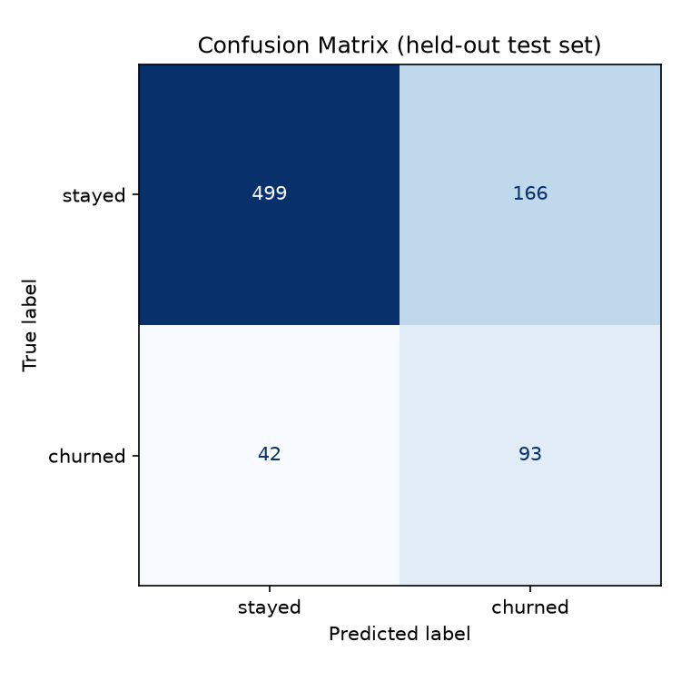
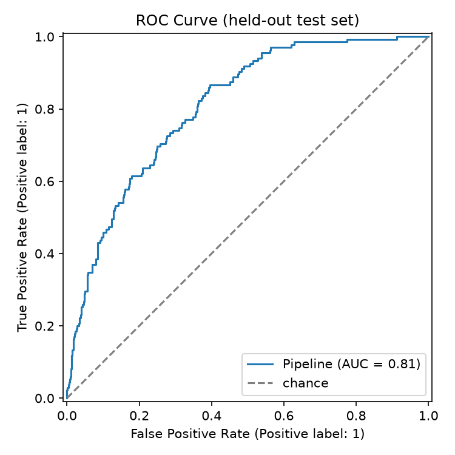

# churn-predictor

[](LICENSE)

**An end-to-end classic-ML pipeline that predicts customer churn from account and usage
features** — synthetic data generation, cleaning/feature engineering, model comparison, real
evaluation metrics and plots, and a CLI to score new customers with a saved model.

There's no bundled real-world churn dataset here on purpose: this project generates its own
synthetic-but-realistic one (churn probability actually depends on the features, with noise, so
the models have something real to learn — see "The dataset" below) and puts the full pipeline
around it, since the goal is to demonstrate the mechanics of a correct ML workflow, not to chase a
leaderboard score on a famous CSV.

## How it works

1. **Data generation** (`churn_predictor/generate_data.py`). Builds ~4,000 synthetic customers —
   tenure, monthly/total charges, contract type, payment method, support-call count, internet
   service tier, add-on count, senior status — and simulates `churned` from a logistic model over
   those features plus Gaussian noise on the logit. Month-to-month contracts, low tenure, many
   support calls, and electronic-check payment push churn probability up; long contracts and
   add-on services push it down. Seeded (`--seed`) for reproducibility.
2. **Preprocessing** (`churn_predictor/preprocess.py`). Pure functions: `clean_data` imputes the
   small amount of missing `total_charges` and clips invalid negatives; `engineer_features` derives
   `avg_charge_per_month`; `get_feature_target` splits `X`/`y` and asserts the target never leaks
   into the feature matrix.
3. **Training** (`churn_predictor/train.py`). Stratified train/test split, then Logistic Regression
   and Random Forest (each wrapped in a preprocessing `Pipeline` — one-hot encoding + scaling) are
   compared via 5-fold cross-validated ROC-AUC on the training split. The winner is refit on the
   full training set, evaluated once on the held-out test set, and saved to
   `models/churn_model.joblib` along with a confusion matrix and ROC curve in `reports/`.
4. **Prediction** (`churn_predictor/predict.py`). Loads the saved pipeline and scores a CSV of new
   customers (same schema, minus `churned`), printing a churn probability per row and optionally
   writing a scored CSV.

## Results (from the committed run)

Real numbers from the training run whose artifacts are committed in this repo
(`data/customers.csv`, `reports/confusion_matrix.png`, `reports/roc_curve.png`,
`models/churn_model.joblib`) — 4,000 synthetic customers, 16.9% churn rate, 80/20 stratified split.

5-fold cross-validated ROC-AUC on the training split:

| Model | Mean ROC-AUC |
| --- | --- |
| **Logistic Regression** (selected) | **0.820** (± 0.026) |
| Random Forest | 0.797 (± 0.033) |

Held-out test-set metrics for the selected model (Logistic Regression, `class_weight="balanced"`):

| Metric | Value |
| --- | --- |
| Accuracy | 0.740 |
| Precision | 0.359 |
| Recall | 0.689 |
| F1 | 0.472 |
| ROC-AUC | 0.808 |

Both models score meaningfully above chance (AUC ~0.5) but nowhere near 1.0 — expected, since churn
labels were generated with real noise on top of the signal. `class_weight="balanced"` is used for
both candidates because churn is the minority class (~17%): the unweighted model had higher
accuracy but recall around 0.22, missing most actual churners, which is the wrong tradeoff for a
churn-prevention use case where a missed churner is more costly than a false alarm.




## Install

Requires Python 3.11+.

```bash
python -m venv .venv
.venv\Scripts\activate       # Windows
# source .venv/bin/activate  # macOS/Linux

pip install -r requirements.txt
pip install -e .              # installs the churn_predictor package + `churn-predictor` CLI
```

## Usage

```bash
# 1. (Re)generate the synthetic dataset -> data/customers.csv
python -m churn_predictor.generate_data

# 2. Train + evaluate, saving models/churn_model.joblib and reports/*.png
python -m churn_predictor train

# 3. Score new customers with the saved model
python -m churn_predictor predict --input data/new_customers.csv --output data/scored.csv
```

`data/new_customers.csv` should have the same columns as `data/customers.csv` minus `churned`.

Equivalent forms (same three commands, via the installed console script):

```bash
churn-predictor train
churn-predictor predict --input data/new_customers.csv
```

Useful flags:

```
python -m churn_predictor train --seed 42 --test-size 0.2 --model-out models/churn_model.joblib
python -m churn_predictor.generate_data --rows 4000 --seed 42
```

### Regenerating the model artifact

`models/churn_model.joblib` is a binary build artifact and is **not** committed (see
`.gitignore`). After cloning, run `python -m churn_predictor train` once to (re)create it — takes a
few seconds on the committed 4,000-row dataset.

## Project structure

```
churn-predictor/
  data/
    customers.csv              synthetic dataset (committed, ~4,000 rows)
  models/
    churn_model.joblib         trained pipeline (gitignored — regenerate with `train`)
  reports/
    confusion_matrix.png       from the committed training run
    roc_curve.png               from the committed training run
  src/churn_predictor/
    __init__.py
    __main__.py                 `train` / `predict` / `generate-data` subcommands
    generate_data.py            synthetic dataset generator
    preprocess.py                cleaning + feature engineering (pure functions)
    train.py                     model comparison, evaluation, artifact saving
    predict.py                   CLI to score new customers with a saved model
  tests/
    test_preprocess.py           feature-engineering/encoding/no-leakage tests
    test_train_smoke.py          end-to-end smoke test on a tiny synthetic sample
  pyproject.toml
  requirements.txt
  LICENSE
```

## Development

```bash
pytest              # run the test suite
ruff check .         # lint
```

Tests cover the preprocessing functions with small hand-built DataFrames (correct missing-value
handling, correct `avg_charge_per_month` derivation, and an explicit assertion that the target
column never ends up in the feature matrix) plus a smoke test that fits both candidate models and
runs the full `train` pipeline end-to-end on a small (200-row) synthetic sample — fast enough to run
on every commit without needing the full 4,000-row dataset.

## Why these design choices

- **Synthetic data, generated deterministically.** No real customer data exists to use, and a
  bundled dataset from an unclear source is worse than being upfront about a seeded, documented
  generator. The generator builds in a real (noisy, non-trivial) relationship between features and
  churn specifically so the trained models have something genuine to learn — not so accuracy comes
  out at a suspicious 99% or a random 50%.
- **`class_weight="balanced"`** on both candidate models, since ~17% churn is a real class
  imbalance and recall matters more than raw accuracy for this problem.
- **A shared `sklearn.Pipeline`** (preprocessing + model) is what actually gets saved, not just the
  fitted estimator — so `predict.py` never has to remember to reapply encoding/scaling by hand, and
  can't silently drift out of sync with how the model was trained.
- **Model selection by cross-validated ROC-AUC**, not a single train/test split, to reduce the
  chance of picking a model that just got lucky on one split; the held-out test set is only touched
  once, after the winner is already chosen.

## License

MIT — see [LICENSE](LICENSE).
